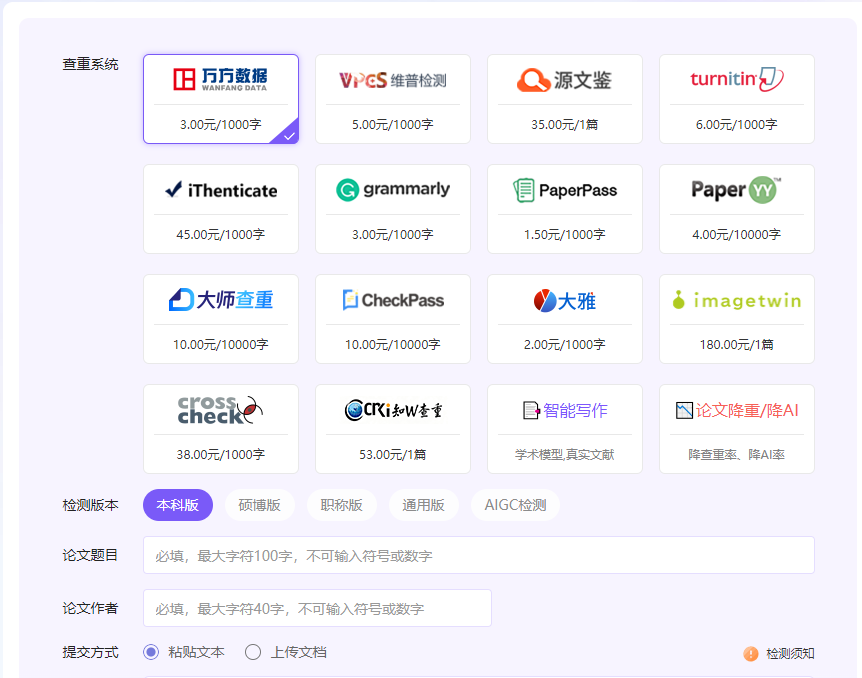
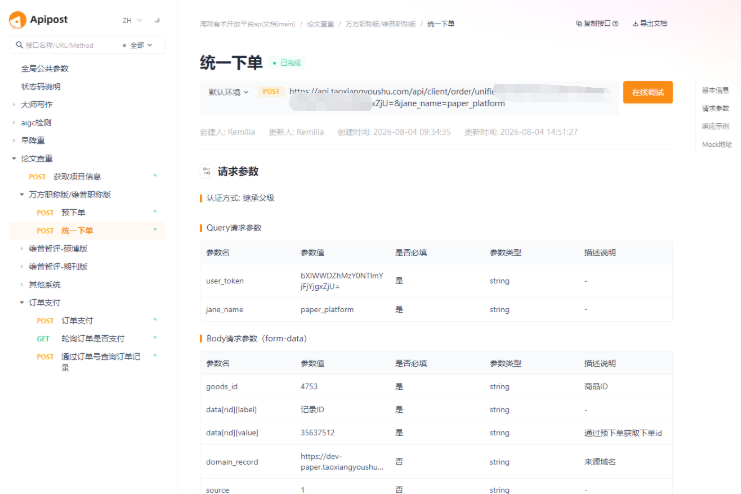
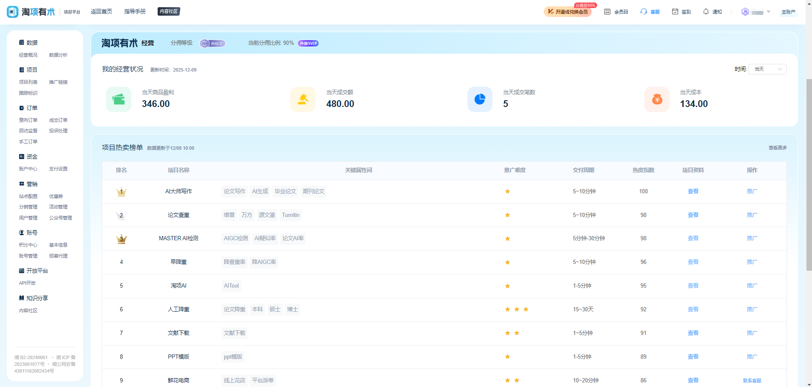

## 🔍 万方论文查重系统 OEM 招商加盟

OEM 万方查重（万方数据）官方同源检测，AIGC 率检测，自动降重，查重报告逐句标红，本科、硕博、期刊投稿、职称评审全覆盖...

🎓 全网已部署百套

🕹️ 五分钟即可开始运营

- 无需编程，无需设计
- 无需购买服务器，无需配置环境
- 0元部署
- 提供数据管理后台
- 赠送SVIP，起步0成本
- 支持API接口调用

## 📝 在线体验地址

- C端(客户端): [https://tx3240.dashixiezuo.com（下面的价格是销售价可以自定义的，非供货价）](https://tx3240.dashixiezuo.com/)

提供APII接口，自定义页面：

- B端(管理端): <https://admins.taoxiangyoushu.com/#/register?code=e5hlRLeu>

可在项目列表-》速盈爆款-》点击商品管理按钮查看详细供货价

 

- 副业介绍: <https://taoxiang.feishu.cn/wiki/HwwfwaCwmiJFdTkx9MqcNWYenYN?from=from_copylink>
- 操作文档: <https://taoxiang.feishu.cn/wiki/Uaf0wALDpivJqJk8u1DcjyWKnhf?from=from_copylink>

## 万方查重版本支持

- 万方数据2.0-本科版: 面向本科毕业论文, 课程论文
- 万方数据2.0-硕博版: 面向硕士, 博士学位论文
- 万方数据2.0-职称版: 面向职称评审, 工作报告
- 万方数据2.0-通用版: 通用检测场景, 期刊投稿, 会议论文, 中英文混排
- 万方数据2.0-AIGC检测: 识别 AI 生成内容, 输出 AIGC 率与修改建议
- 参考文献自动剔除, 检测结果与万方官方报告一致

## C端功能特性

- 🚀一键上传论文, 支持 Word/PDF/TXT, 万字长文快速出万方查重报告
- 🔥对接万方数据官方查重源, 检测结果与官方报告一致
- 🔥支持 AIGC 率检测, 识别 AI 生成内容并给出修改建议
- 🔥查重报告逐句标红, 重复来源可追溯到具体文献
- 覆盖本科, 硕博, 期刊, 职称等万方查重版本
- 支持分段查重与全文查重, 按次或按字数计费
- 支持查重报告导出 PDF/Word, 可自定义报告样式
- 🔥支持匿名检测, 无需登录即可下单
- 🔥支持PC端, 移动端, 微信内直接打开
- 支持API调用和定制
- 支持二级分销, 活动营销等玩法
- 🔥支持微信、支付宝、小红书等支付方式
- 提供C端源码, 可二次开发

## B端功能特性

- 🚀提供数据管理后台其中主账号1个,子账号5个(每个子账号数据独立, 享有主账号所有功能和权限,相当于以下所有功能配置×6)
- 支持用户注册, 登录, 个人信息维护
- 🔥支持订单管理, 订单支付, 订单退款
- 🔥支持数据统计, 分析, 报表等功能
- 🔥支持一键配置专属域名(免费)
- 支持绑定自有域名(CNAME解析)
- 支持配置客服信息(如:客服微信,客服邮箱,客服电话)
- 支持设置跟踪链接(统计流量来源与转化)
- 支持自定义调整销售价(固定计费或阶梯计费)
- 支持自定义产品增值服务启用状态和默认勾选
- 支持配置查重源开关、查重套餐与按字数计价
- 支持在打包文件中插入自定义文件(如查重报告说明文档)
- 支持数据分享(如分享给二级代理销售数据)
- 🔥支持平台收款(如:微信支付,支付宝支付)或绑定自有支付账号(利润直接到账)
- 平台代收利润随时可提现, 资金秒到账
- 🔥支持查看意向订单,成交订单,订单详情(包括用户信息, 订单金额, 订单状态, 订单时间, 来源, 域名, 提交信息,订单日志等)
- 支持手工提交查重降重订单(checkPass每日免费十次)
- 🔥支持配置微信支付, 支付宝支付, 小红书支付, 淘宝支付
- 🔥支持优惠券生成(免费券,折扣券,满减券,直减券), 自定义可复用次数、发放量、有效期
- 提供分销功能(如:二级分销)
- 🔥提供活动管理,活动配置(分享到指定渠道后, 获取指定奖励)
- 支持公众号配置(如活动关注公众号自动发优惠券)
- 拥有用户等级, 积分系统
- 支持配置360oCPC、百度oCPC
- 🔥支持配置网站名称、关键词、描述、百度统计代码(seo优化)
- 🔥支持主题设置、logo设置、icon设置
- 🔥支持报告logo设置, 自定义报告ico
- 提供API接口文档, 方便开发者调用,
- 提供前端源码二次开发部署
- 🔔其他功能可自行探索

## 系统特性

💥💥💥支持OEM一键免费部署

- 拥有自有品牌
- 支持个性化样式定制
- 灵活使用SAAS系统
- 灵活的价格体系
- 多级分销体系
- 支持二级代理
- 支持电商渠道激活码/核销码/渠道码
- 一站式运维让你专注运营推广

## 多端支持

- PC端查重与报告查看
- 移动端、微信内查重下单

## API接口支持

- 支持万方查重任务提交
- 支持查重结果回调通知
- 支持AIGC率检测接口
- ... ...

## 📢OEM加盟 / 合伙人招商创业

- 支持合伙人，招商创业加盟
- 支持分销
- 报表明细一目了然
- 用户注册、使用日志报表

## 🤝联系我们(请在微信备注: 合作合伙人)

- 微信: kelelw520
- 联系客服可以领取60天平台**SVIP兑换码**

